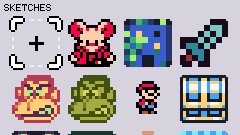

# BitMap16 DX

BitMap16 DX is a tiny pixel-art sketchbook for Cardputer ADV and Cardputer Zero,
channeling the vibe of 2000s handheld game consoles. Steam coming soon.

**[ADV](platform_adv/README.md) · [Zero](platform_zero/README.md) · [Steam — coming soon](platform_steamdeck/README.md)**

## Features

- 8×8, 16×16, and 32×32 canvas modes
- Draw, Erase, Fill, Erase Fill, and Move tools
- Canvas zoom and pixel-accurate minimap (ADV/Zero)
- Undo and redo with 16 steps of session history; opening or creating a sketch clears history
- Save, open, duplicate, preview, and delete sketches
- Built-in 16, 8, and 4-color palettes
  - Palette swapping preserves indexed artwork when moving between smaller
    and larger palettes
  - Import Lospec `.hex` palettes containing any number of colors from 4 through 16
  - Zero and Steam Deck: browse a daily Lospec feed or import by name/URL
  - Color filters group palettes into 4, 5–8, and 9–16 colors
  - StampS3A LED displays currently selected color (ADV)
- Export PNG artwork at 128×128 or its original canvas size
- Light and dark themes
- Preview/gallery mode
- Screensaver
- Shake-to-undo (ADV/Zero)
- Display mirroring with Puzzle Unit 8×8 RGB LED Matrix modules (WS2812E) (ADV)

## Choose your platform

Each guide covers installation, first launch, controls, everyday use, and troubleshooting.

| Platform guide | Contents |
|---|---|
| [Cardputer ADV →](platform_adv/README.md) | Firmware, SD card setup, keyboard controls, RGB matrix |
| [Cardputer Zero →](platform_zero/README.md) | Installation, keyboard controls, Lospec, device settings |
| [Steam →](platform_steamdeck/README.md) | *Coming soon* Development build setup and controls |

## Using Bitmap16 DX

### Draw

Move the cursor and use Draw or Erase to edit pixels. Hold either action while
moving to draw a line. Fill colors a connected region; Erase Fill clears it.
Move shifts your artwork. Use Undo to reverse an edit and Redo to restore it.

Choose an 8×8, 16×16, or 32×32 canvas with Resize Canvas. Shrinking hides pixels
outside the new size without erasing them. On ADV and Zero, zoom in for finer
editing and use the minimap to keep track of your position.

### Choose a palette

Open Palettes, browse the cartridges, and apply one to your drawing. Filter
by 4, 5–8, or 9–16 colors, or show only your saved user palettes.
Changing palettes preserves the arrangement of your pixels.

Add custom palettes using Lospec `.hex` files with 4–16 colors. Zero and
Steam Deck also let you browse the Lospec feed or import a palette by name or
URL. Successful imports save and apply the palette. The feed refreshes locally
on the first visit each day; cached palettes remain available offline.
See your platform guide for controls and palette folder locations.

### Save and manage sketches

Save updates the current sketch; Save As creates another copy. Open Sketches
to create a drawing, reopen saved artwork, duplicate it, or delete it. Preview
shows artwork without the editing tools; the slideshow lets you browse saved
sketches or advance through them automatically.

Sketches store their own palette colors, so deleting a saved palette does not
change existing artwork.

### Export and customize

Export saves a scaled 128×128 PNG or a Native PNG at the original canvas size.
Your platform guide explains where to find the files.

Settings includes the theme, default canvas size, and export format, alongside
options for your device. Open Help for the controls available on your platform.

## Downloads and releases

The latest release is **v0.9.0** for Cardputer ADV and Cardputer Zero.
Download the file for your device from the
[v0.9.0 release](https://github.com/bradmcnally/bitmap16dx/releases/tag/v.0.9.0):

| Device | Download | Install |
|---|---|---|
| Cardputer ADV | [`bitmap16dx-v0.9.0.bin`](https://github.com/bradmcnally/bitmap16dx/releases/download/v.0.9.0/bitmap16dx-v0.9.0.bin) | Flash the firmware to your ADV. See the [ADV guide](platform_adv/README.md). |
| Cardputer Zero | [`bitmap16dx_0.9.0-1_arm64.deb`](https://github.com/bradmcnally/bitmap16dx/releases/download/v.0.9.0/bitmap16dx_0.9.0-1_arm64.deb) | Install the package on your Zero. See the [Zero guide](platform_zero/README.md). |

See [CHANGELOG.md](CHANGELOG.md) for release notes. Steam / Steam Deck is coming soon.

## Building and contributing

See the [development guide](docs/development.md) for source builds, packaging,
simulators, and validation, and the [Cloudflare feed setup](services/lospec-feed/README.md)
for hosting the palette feed. Zero packaging and submission instructions are
in the [store release guide](platform_zero/STORE.md).
