# BitMap16 DX

BitMap16 DX is a tiny pixel-art sketchbook for the M5Stack Cardputer ADV,
channeling the vibe of 2000s handheld game consoles.

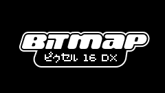
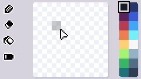


## Features

- 8×8, 16×16, and 32×32 canvas modes
- Draw, Erase, Fill, Erase Fill, and Move tools
- Canvas zoom and pixel-accurate minimap
- Undo and redo with 16 steps of session history; opening or creating a sketch clears history
- Holding draw, erase, or artwork move counts as one undo step until release
- Save, open, duplicate, preview, and delete sketches from SD card
- Built-in 16, 8, and 4-color palettes
  - Palette swapping preserves indexed artwork when moving between smaller
    and larger palettes
  - Import Lospec `.hex` palettes containing any number of colors from 4 through 16
  - Zero and Steam Deck: browse a shared daily Lospec feed or import by name/URL
  - Color filters group palettes into 4, 5–8, and 9–16 colors
  - StampS3A LED displays currently selected color
- Export `.png` files to `bitmap16dx/exports/` at 128×128 or logical size
- Light and dark themes
- Preview/gallery mode
- Screensaver with animated icons and artwork; Zero shows live charging status
- Shake-to-undo
- Display mirroring with Puzzle Unit 8×8 RGB LED Matrix modules (WS2812E)

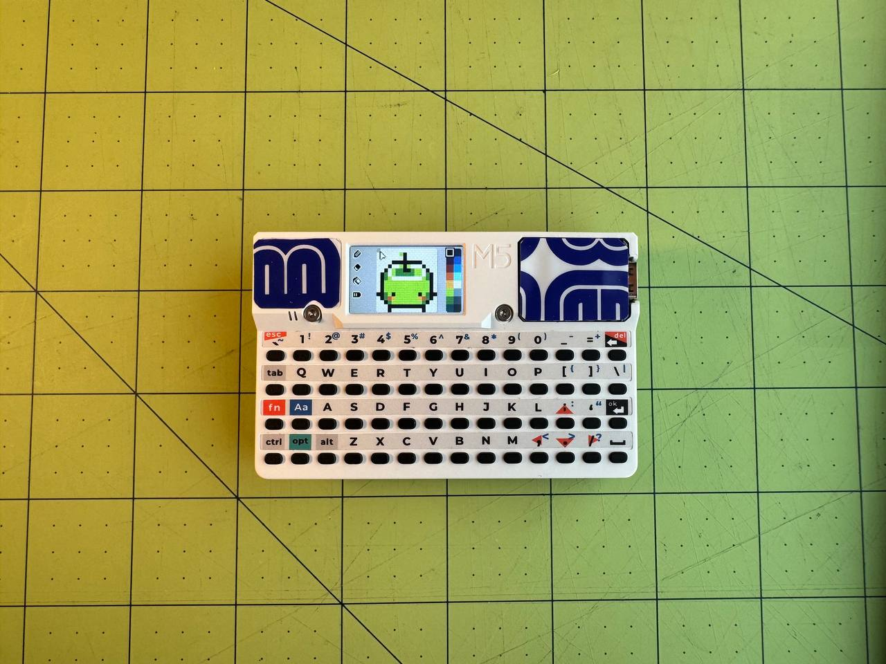

## First boot

1. **Insert SD card** before powering on (FAT32 format recommended)
2. Power on your Cardputer
3. BitMap16 DX will automatically create these folders:
   ```
   /bitmap16dx/
   ├── sketches/   # Your saved artwork
   ├── exports/    # Exported PNG files
   └── palettes/   # Custom color palettes (optional)
   ```
4. Start drawing!

## Adding custom palettes (Optional)
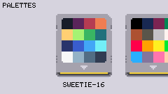
1. Download `.hex` palette files from [Lospec](https://lospec.com/palette-list)
2. Copy to `/bitmap16dx/palettes/` on your SD card
3. Power cycle your Cardputer
4. Access custom palettes in the Palette Menu

Current source builds support every palette size from **4 through 16 colors**,
retaining the palette's actual color count. The ADV supports up to 32 palettes
(12 built-in and 20 custom); Zero and Steam Deck support the 12 built-in
palettes plus up to 116 saved user palettes.

## How to Use

For the Cardputer Zero, see the [complete keyboard reference](platform_zero/README.md#cardputer-zero-keyboard-reference).

### Drawing Mode

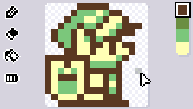
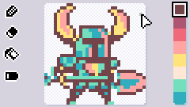
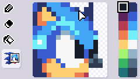


| Key | Function |
|-----|----------|
| Arrow keys (`↑` `←` `↓` `→`) | Move cursor (hold to repeat) |
| `ctrl, ok`/`enter ` | Place pixel with selected color |
| `del`/`backspace` | Erase pixel |
| `F` | Flood **f**ill |
| `fn` + `F` | Flood fill with transparency (**Erase Fill**) |
| `M` + `Arrow keys` | **M**ove canvas |
| `1-8` | Quick color selection (colors 1-8) |
| `fn` + `1-8` | Quick color selection (colors 9-16) |
| `C` | **C**ycle to next color |
| `G` | Open Resize Canvas; choose a size, then select Apply |
| `+` / `-` | Zoom canvas in/out at integer pixel scales |
| `fn` + `Arrow keys` | While zoomed, jump to that edge of the artwork |
| `R` | Toggle viewport-centered **r**ulers |
| `T` | Toggle Se**t**tings |
| `Z` | Undo last action (or shake when enabled) |
| `fn` + `Z` | Redo last action |
| `g0` button | Clear canvas |
| `S` | **S**ave sketch (update current or create new) |
| `FN` + `S` | **S**ave as new sketch (always creates new file) |
| `X` | E**x**port PNG (128×128 scaled) |
| `FN` + `X` | Export PNG at its logical grid size |
| `H` | Open **h**elp screen (key commands) |
| `P` | Open **P**alette Menu |
| `O` | **O**pen Sketches Menu |
| `V` | Open Pre**v**iew Mode |
| `B` + `+/-` | Adjust **b**rightness |
| `FN` + `B` | Screensaver |
| `L` + `Ok` | RGB Matrix on/off |
| `L` + `+/-` | RGB Matrix brightness |

### Drawing Preview *(V)*

| Key | Function |
|-----|----------|
| `1` | Black background |
| `2` | White background |
| `3` | Light gray background |
| `4` | Dark gray background |
| `+` / `-` | Zoom preview at integer scales |
| `esc` | Dismiss |

### Palette Menu *(P)*

| Key | Function |
|-----|----------|
| `←`/`→` | Navigate palettes |
| `ok`/`enter` | Select palette |
| `esc` | Dismiss |
| `4` | Toggle the 4-color filter |
| `8` | Toggle the 5–8-color filter |
| `1` | Toggle the 9–16-color filter |
| `U` | Toggle custom user palettes filter (can be combined with 4/8/16 filters) |
| `0` | Clear all filters |

### Online palettes on Zero and Steam Deck

On Zero, press `I` in Palettes to **Import from Lospec**, or `L` to
**Browse Lospec**. On Steam Deck, use `L3` to import and `Y` to browse.

- The browser shows the shared feed's newest palettes with 4–16 colors in one
  continuous cartridge carousel. Saved Lospec palettes are omitted; there is
  no likes threshold. Browse and filter offline after downloading the feed.
- The shared feed refreshes once daily and checks up to 300 newest palettes.
  Refresh the app's copy with `R` on Zero or `X` on Steam Deck. Browsing and
  filtering make no additional network requests.
- Import accepts a palette slug such as `endesga-16` or a full Lospec palette
  URL. Zero uses its physical keyboard; Steam Deck uses the SteamOS system
  keyboard (Steam + X) or a physical keyboard. The empty field shows a gray example chosen each time it opens.
- Enter moves focus from the text field to Import; Enter again
  fetches the palette. Up returns to editing, `Ctrl+V` pastes when available,
  and Escape cancels. The insertion cursor blinks while the field is focused.
- A successful lookup opens a cartridge preview. Enter / `A` saves and applies
  it; Escape / `B` returns to local Palettes without saving.
- Escape / `B` navigates **Lospec → local Palettes → Canvas**, one press per step.
- Steam Deck: LB/RB cycles color-range filters, D-pad Up toggles local user
  palettes, and D-pad Down clears filters.
- Backspace/Delete on Zero or `X` on Steam Deck moves a saved user palette to
  trash. Built-in palettes are protected. Artwork stores its own colors, so
  deleting a palette does not change existing sketches.

The focused cartridge rises 8 pixels as it reaches the center. Opening
Palettes uses a center-out entrance wave; switching lists or filters reloads
cartridges in place. Each cartridge shows its actual color count.
The ADV uses the same entrance, focus, filter-reload, and exit animations for
its local palette collection.

Players do not need API keys. See the [Zero guide](platform_zero/README.md),
[Steam Deck guide](platform_steamdeck/README.md), and
[shared Cloudflare feed setup](services/lospec-feed/README.md) for details.

### Dialogs

Move focus with arrows / D-pad, select with Enter / `A`, and cancel with
Escape / `B`. Save warnings default to Save; sketch deletion defaults to
Cancel and always asks for confirmation.

On ADV and Zero, `G` opens Resize Canvas; on Steam Deck, use L3 or L4.
Left/Right chooses a size; Enter / `A` moves to Apply, then another press confirms. Up returns to the size row. The `>` marker stays
on the applied size, while an outline marks the pending size when focus moves
to the buttons. Shrinking hides pixels outside the new grid without erasing
them, and resizing can be undone.

### Sketches Menu *(O)*


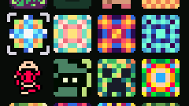

| Key | Function |
|-----|----------|
| Arrow keys (`↑` `←` `↓` `→`) | Navigate sketch grid |
| `ok`/`enter` | Load selected sketch |
| `V` | Open slideshow **v**iew |
| `esc` | Dismiss |
| `g0` button | Confirm deletion of the focused sketch (Cancel selected initially) |
| `Z` | Restore the most recently deleted sketch |
| `fn` + `S` | Duplicate the focused sketch |

### Sketch Slideshow View *(V from Sketches Menu)*

View your saved sketches in a fullscreen slideshow with optional auto-advance.

| Key | Function |
|-----|----------|
| `←`/`→` | Navigate previous/next sketch |
| `space` | Toggle auto-advance (3 second intervals) |
| `1` | Black background |
| `2` | White background |
| `3` | Light gray background |
| `4` | Dark gray background |
| `B` + `+/-` | Adjust **b**rightness |
| `esc` | Return to Sketches |

### Settings *(T)*

- Set UI theme (light, dark)
- Set default grid (8×8, 16×16, or 32×32)
- Set export format (RGB888, RGB565)
- RGB Matrix settings:
  - Enable/disable matrix output
  - Set matrix layout (1 or 4 units)
  - Set matrix rotation (0°, 90°, 180°, or 270°)
  - Set matrix brightness
- Enable Shake to Undo (IMU accelerometer)
- Enable or disable save warnings
- Indicator LED settings:
  - Show the currently selected palette color
  - Override the palette color with a red low-battery warning at 10%

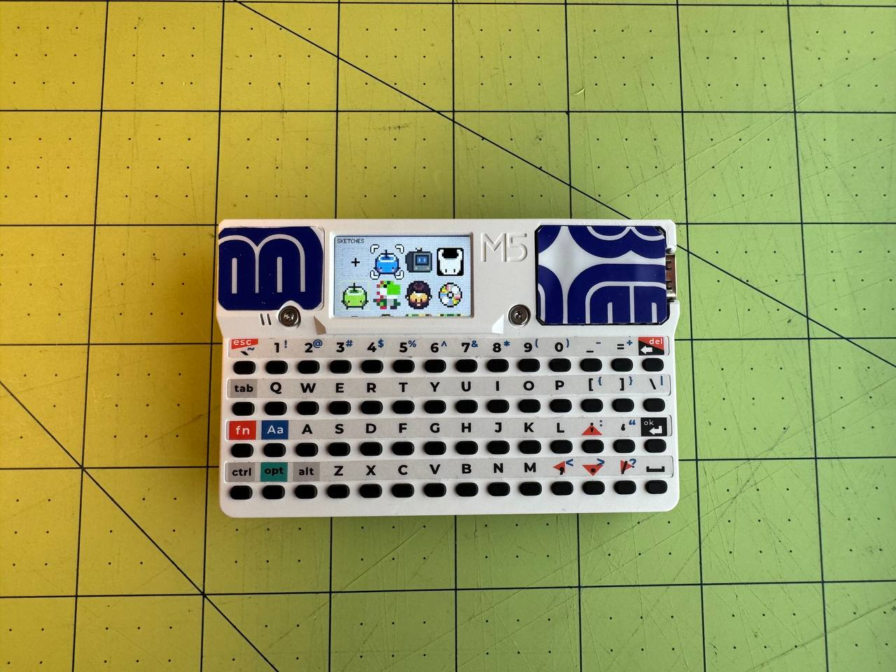
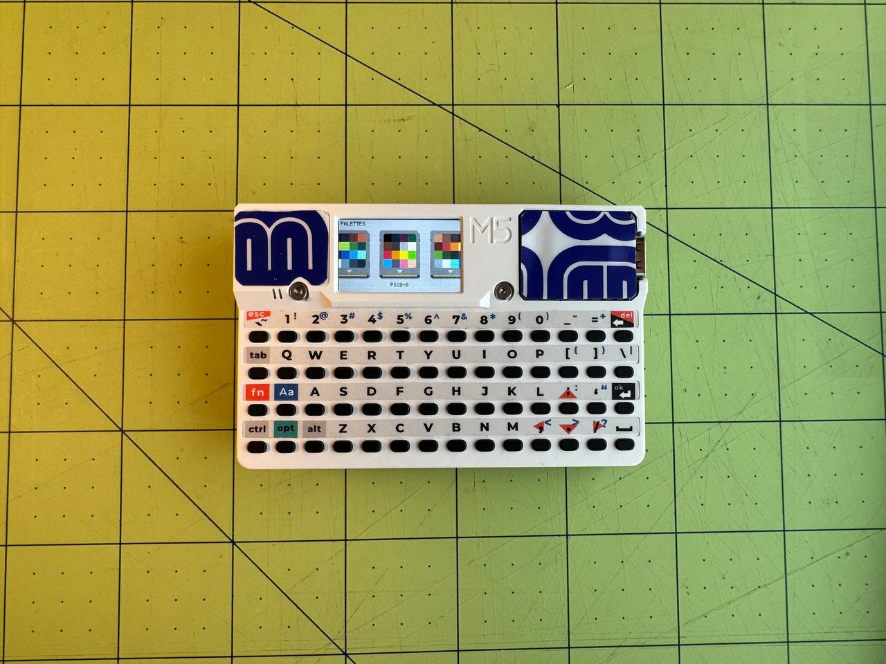

## RGB LED Matrix mirroring

The RGB LED matrix display mirrors your canvas in real time. Connect one or
four Puzzle Unit 8×8 RGB LED Matrix (WS2812E) modules to the Cardputer ADV
expansion port. Matrix power, layout, brightness, and rotation are configurable
from the nested RGB Matrix settings page.

When editing zoomed 16×16 or 32×32 artwork, the matrix displays the region
currently visible in the canvas viewport.

### Quad Matrix (16x16)

<p>
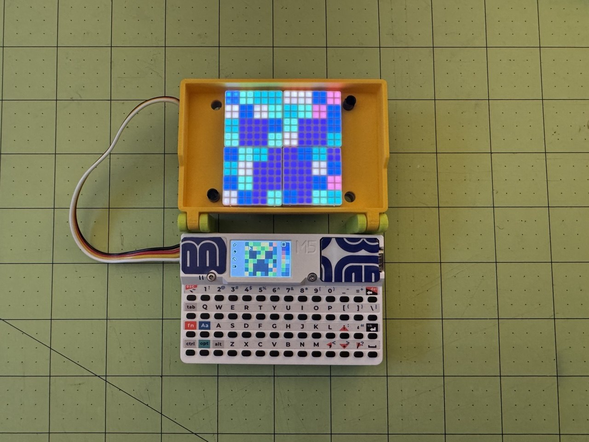
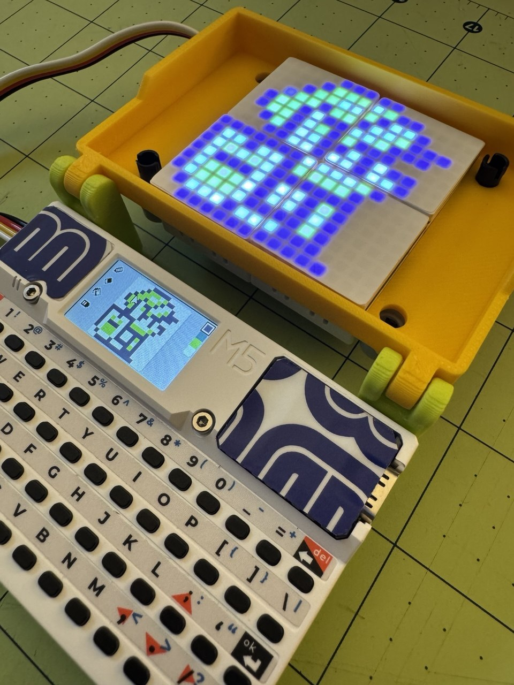
</p>

### Single Matrix (8x8)

<p>
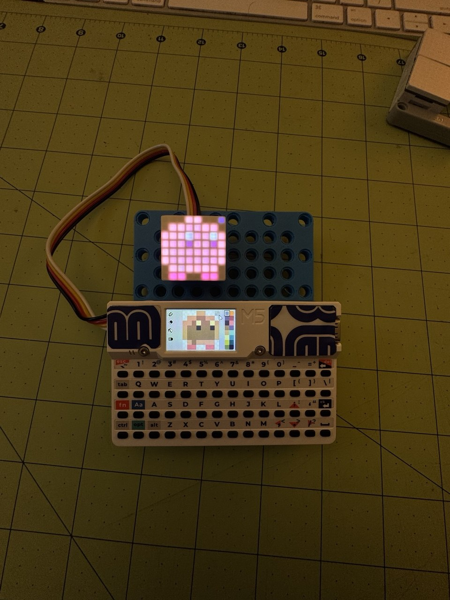
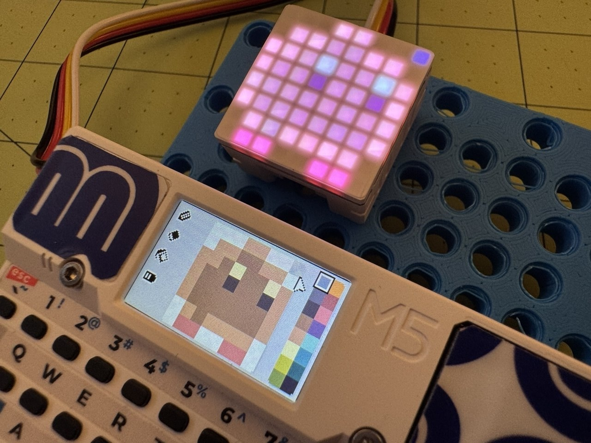
</p>

### Technic Panel Board

<p>
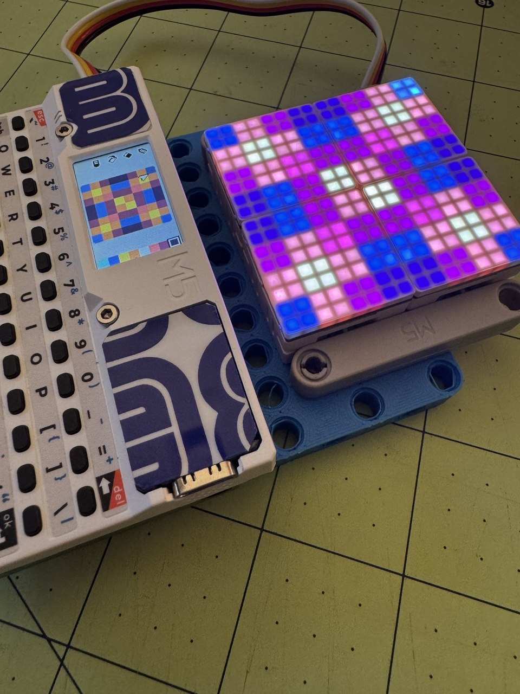
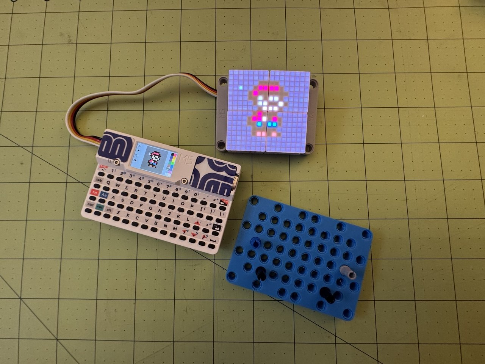
</p>

A Cardputer-sized prototype board with Lego Technic-compatible mounting holes. Designed for snapping peripherals — like the RGB matrix modules — into modular, reconfigurable layouts.

## Current release

The current hardware release targets the **M5Stack Cardputer ADV**. The
repository includes source builds for Steam Deck, Linux desktop, and Cardputer
Zero. The downloadable firmware is for the ADV.

The next ADV release is **v0.8.0 — The Blast Processing Update**. See
[CHANGELOG.md](CHANGELOG.md) for the complete release notes and
[the ADV release checklist](docs/adv_release_test_checklist.md) for physical
device validation.

### Project Structure

```
bitmap16dx/
├── platformio.ini          # PlatformIO configuration
├── CMakeLists.txt          # SDL development builds
├── platform_desktop/       # Shared desktop/Steam Deck/Zero SDL shell
├── platform_steamdeck/     # Steam Deck packaging and sideload files
├── platform_zero/          # Cardputer Zero simulator/runtime files
├── src/
│   ├── main.cpp            # Cardputer ADV application
│   ├── core/               # Shared editor, views, codecs, and settings
│   ├── platform/           # ADV hardware adapters
│   ├── palettes.h          # Built-in palette definitions
│   ├── icons.h             # UI icons
│   └── boot_image.h        # Splash screen
├── test/                   # Native shared-core tests
└── docs/                   # Porting and release validation documents
```

## Build and install the ADV firmware

The PlatformIO environment is named `m5stack-cardputer` and builds the
Cardputer ADV firmware:

```sh
pio run -e m5stack-cardputer
```

To upload to an attached ADV:

```sh
pio run -e m5stack-cardputer -t upload
```


### Cardputer Zero device build

See the [Cardputer Zero build and install guide](platform_zero/README.md)
to build the Linux package and launch it from HOME.

### Desktop and Cardputer Zero simulator

The repository includes SDL2 simulators for the 240×135 Cardputer ADV layout
and the 320×170 Cardputer Zero layout:

```sh
cmake --preset desktop
cmake --build --preset desktop
./build/desktop/bitmap16dx_desktop

cmake --preset zero
cmake --build --preset zero
./build_zero/bitmap16dx_desktop
```

The simulator persists sketches, exports, settings, and custom palettes under
`~/.local/share/bitmap16dx`. The desktop ADV simulator also opens an RGB-matrix
simulation window. RGB matrix support and its controls are disabled for Zero
and Steam Deck builds.

Icons are embedded directly in `src/icons.h`, `src/screensaver_icons.h`, and
`src/core/dialog_artwork.h`; no separate icon files are needed at runtime.

### Steam Deck development build

The Deck preset renders a 320×200 logical framebuffer at an exact 4× scale on
the 1280×800 display and enables SDL controller input:

```sh
cmake --preset steamdeck
cmake --build --preset steamdeck
```

See [the Steam Deck sideload guide](platform_steamdeck/README.md) for the
controller layout and copy/run instructions.
