# Cardputer ADV guide

## Install

Download the ADV firmware from [GitHub Releases](https://github.com/bradmcnally/bitmap16dx/releases)
or [M5Launcher](https://bmorcelli.github.io/Launcher/) and flash it to your Cardputer ADV. To build and upload from source, see the
[development guide](../docs/development.md#build-and-install-the-adv-firmware).

## First launch

1. **Insert SD card** before powering on (FAT32 format recommended)
2. Power on your Cardputer
3. BitMap16 DX will automatically create these folders:
   ```
   /bitmap16dx/
   ├── sketches/   # Your saved artwork
   ├── exports/    # Exported PNG files
   └── palettes/   # Custom color palettes (optional)
   ```
4. Start drawing!

## Controls

### Drawing Mode

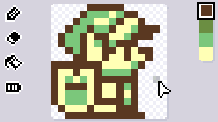
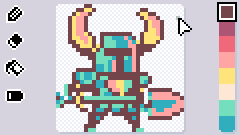
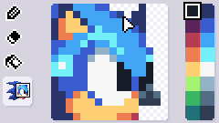


| Key | Function |
|-----|----------|
| Arrow keys (`↑` `←` `↓` `→`) | Move cursor (hold to repeat) |
| `ctrl, ok`/`enter ` | Place pixel with selected color |
| `del`/`backspace` | Erase pixel |
| `F` | Flood **f**ill |
| `fn` + `F` | Flood fill with transparency (**Erase Fill**) |
| `M` + `Arrow keys` | **M**ove canvas |
| `1-8` | Quick color selection (colors 1-8) |
| `fn` + `1-8` | Quick color selection (colors 9-16) |
| `C` | **C**ycle to next color |
| `G` | Open Resize Canvas; choose a size, then select Apply |
| `+` / `-` | Zoom canvas in/out at integer pixel scales |
| `fn` + `Arrow keys` | While zoomed, jump to that edge of the artwork |
| `R` | Toggle viewport-centered **r**ulers |
| `T` | Toggle Se**t**tings |
| `Z` | Undo last action (or shake when enabled) |
| `fn` + `Z` | Redo last action |
| `g0` button | Clear canvas |
| `S` | **S**ave sketch (update current or create new) |
| `FN` + `S` | **S**ave as new sketch (always creates new file) |
| `X` | E**x**port PNG (128×128 scaled) |
| `FN` + `X` | Export Native PNG at the original canvas size |
| `H` | Open **h**elp screen (key commands) |
| `P` | Open **P**alette Menu |
| `O` | **O**pen Sketches Menu |
| `V` | Open Pre**v**iew Mode |
| `B` + `+/-` | Adjust **b**rightness |
| `FN` + `B` | Screensaver |
| `L` + `Ok` | RGB Matrix on/off |
| `L` + `+/-` | RGB Matrix brightness |

### Drawing Preview *(V)*

| Key | Function |
|-----|----------|
| `1` | Black background |
| `2` | White background |
| `3` | Light gray background |
| `4` | Dark gray background |
| `+` / `-` | Zoom preview at integer scales |
| `esc` | Dismiss |

### Palette Menu *(P)*

| Key | Function |
|-----|----------|
| `←`/`→` | Navigate palettes |
| `ok`/`enter` | Select palette |
| `esc` | Dismiss |
| `4` | Toggle the 4-color filter |
| `8` | Toggle the 5–8-color filter |
| `1` | Toggle the 9–16-color filter |
| `U` | Toggle custom user palettes filter (can be combined with 4/8/16 filters) |
| `0` | Clear all filters |

### Sketches Menu *(O)*


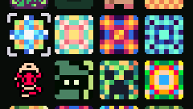

| Key | Function |
|-----|----------|
| Arrow keys (`↑` `←` `↓` `→`) | Navigate sketch grid |
| `ok`/`enter` | Load selected sketch |
| `V` | Open slideshow **v**iew |
| `esc` | Dismiss |
| `g0` button | Delete the focused sketch |
| `Z` | Restore the most recently deleted sketch |
| `fn` + `S` | Duplicate the focused sketch |

### Sketch Slideshow View *(V from Sketches Menu)*

View your saved sketches in a fullscreen slideshow with optional auto-advance.

| Key | Function |
|-----|----------|
| `←`/`→` | Navigate previous/next sketch |
| `space` | Toggle auto-advance (3 second intervals) |
| `1` | Black background |
| `2` | White background |
| `3` | Light gray background |
| `4` | Dark gray background |
| `B` + `+/-` | Adjust **b**rightness |
| `esc` | Return to Sketches |

## Using the app

See [Using Bitmap16 DX](../README.md#using-bitmap16-dx) for the drawing, sketches,
and export workflow.

### Custom palettes
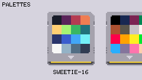
1. Download `.hex` palette files from [Lospec](https://lospec.com/palette-list)
2. Copy to `/bitmap16dx/palettes/` on your SD card
3. Power cycle your Cardputer
4. Access custom palettes in the Palette Menu

Palettes can contain **4 through 16 colors**. The ADV supports up to 32 palettes
(12 built-in and 20 custom).

### Settings *(T)*

- Set UI theme (light, dark)
- Set default grid (8×8, 16×16, or 32×32)
- Set export format (RGB888, RGB565)
- RGB Matrix settings:
  - Enable/disable matrix output
  - Set matrix layout (1 or 4 units)
  - Set matrix rotation (0°, 90°, 180°, or 270°)
  - Set matrix brightness
- Enable Shake to Undo (IMU accelerometer)
- Enable or disable save warnings
- Indicator LED settings:
  - Show the currently selected palette color
  - Override the palette color with a red low-battery warning at 10%

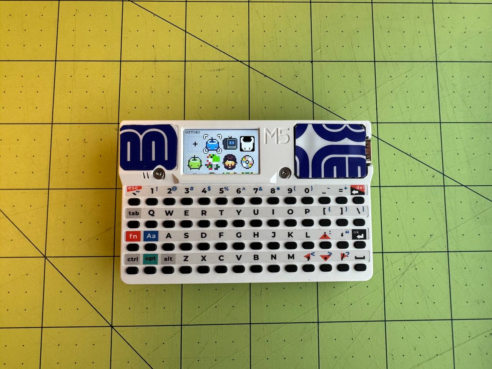
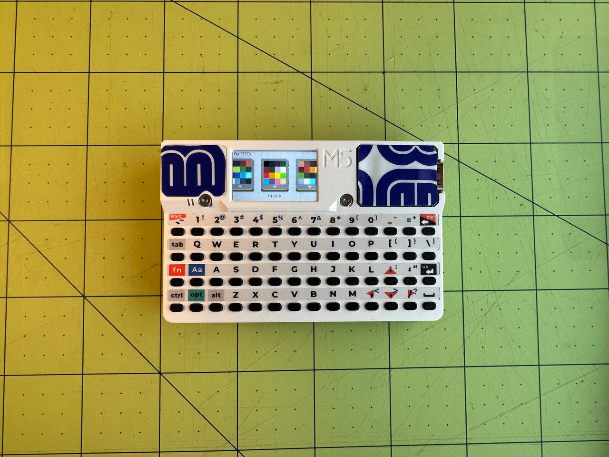

## RGB LED Matrix mirroring

The RGB LED matrix display mirrors your canvas in real time. Connect one or
four Puzzle Unit 8×8 RGB LED Matrix (WS2812E) modules to the Cardputer ADV
expansion port. Matrix power, layout, brightness, and rotation are configurable
from the nested RGB Matrix settings page.

When editing zoomed 16×16 or 32×32 artwork, the matrix displays the region
currently visible in the canvas viewport.

### Quad Matrix (16x16)

<p>
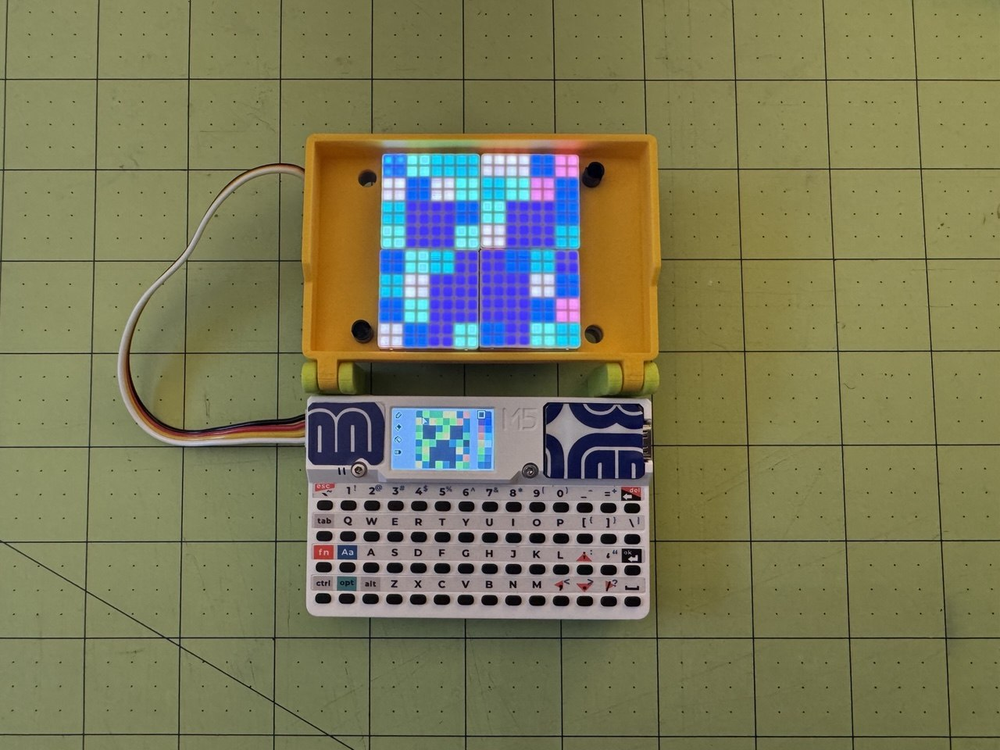
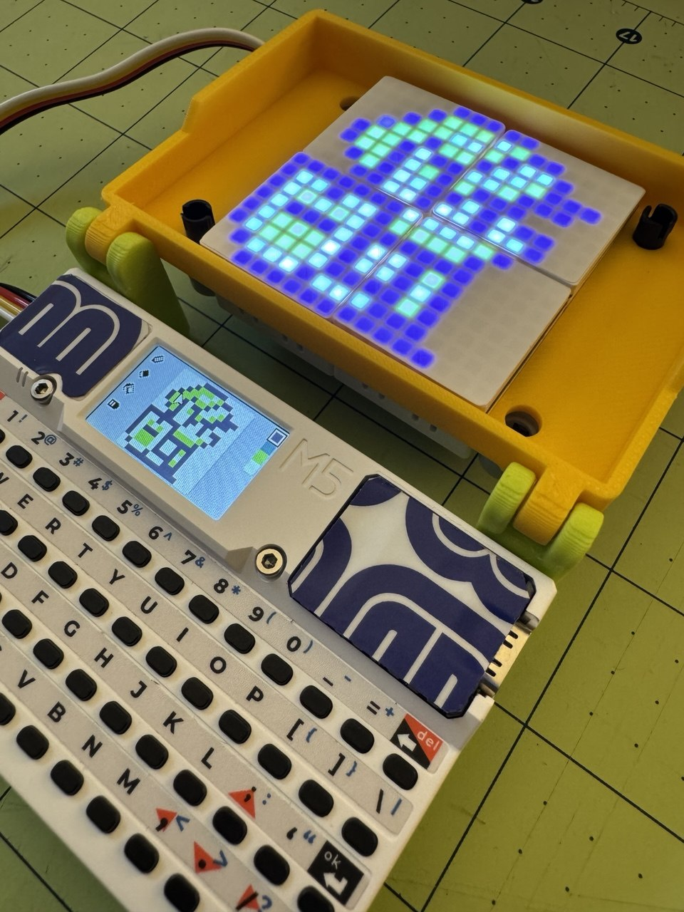
</p>

### Single Matrix (8x8)

<p>
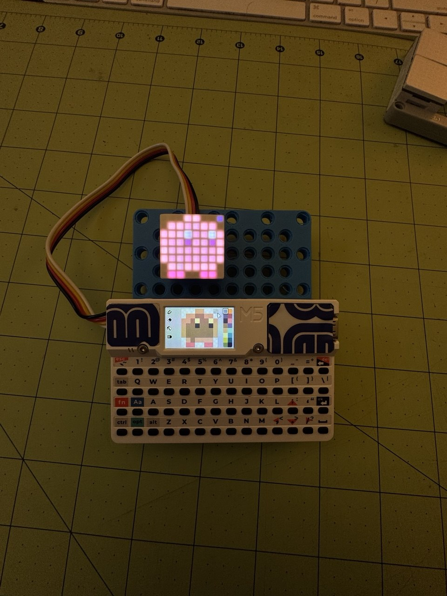
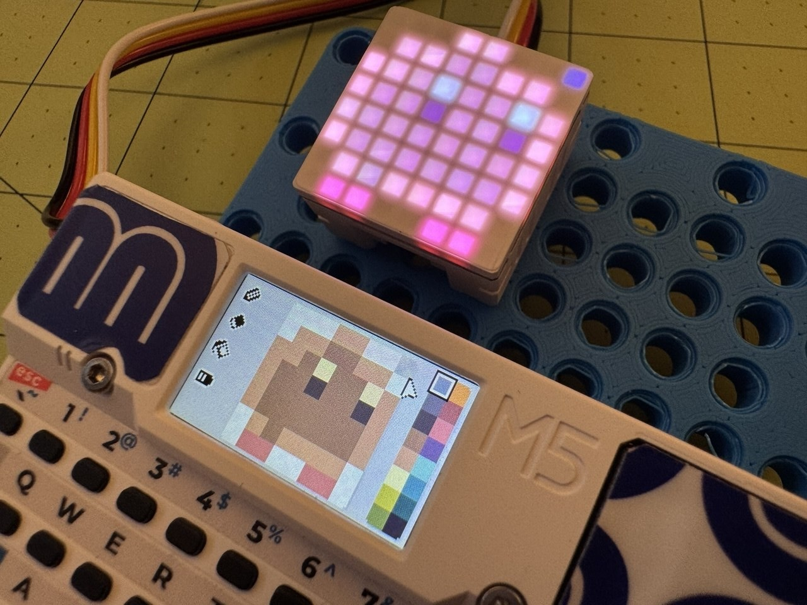
</p>

### Technic Panel Board

<p>
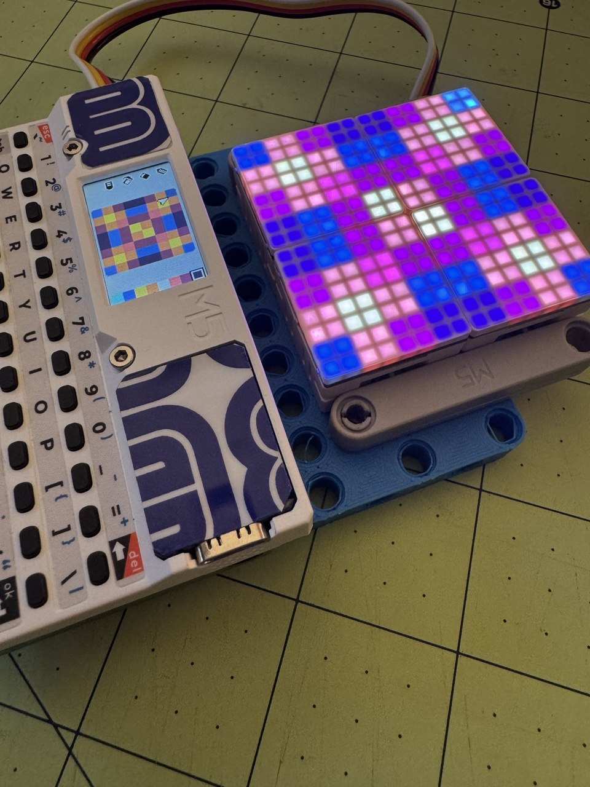
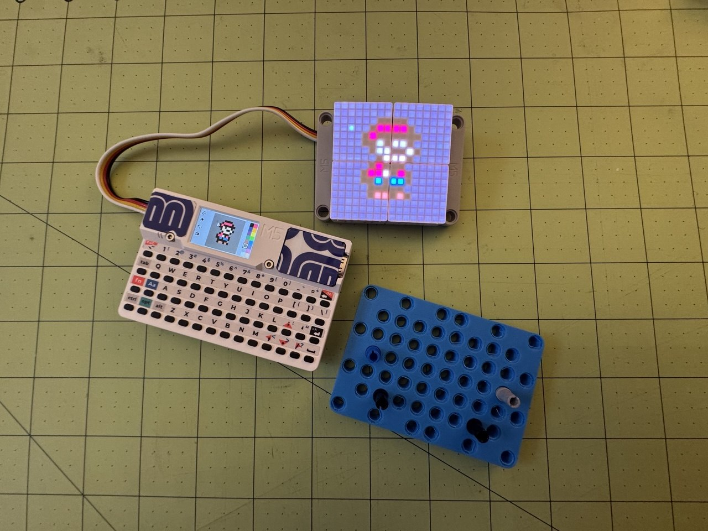
</p>

A Cardputer-sized prototype board with Lego Technic-compatible mounting holes. Designed for snapping peripherals — like the RGB matrix modules — into modular, reconfigurable layouts.

## Troubleshooting

- If sketches or palettes do not appear, check that the SD card is inserted
  and formatted as FAT32, and that files are in the folders listed above.
- For custom palettes, use Lospec `.hex` files with 4–16 colors and restart
  after copying them to the SD card.
- For matrix output, check the connection, enabled state, layout, and brightness
  in RGB Matrix settings.

For firmware validation, see the [ADV release checklist](../docs/adv_release_test_checklist.md).

## Hardware reference

[Cardputer ADV dimensional template (PDF)](hardware/cardputer-ADV-template.pdf)
